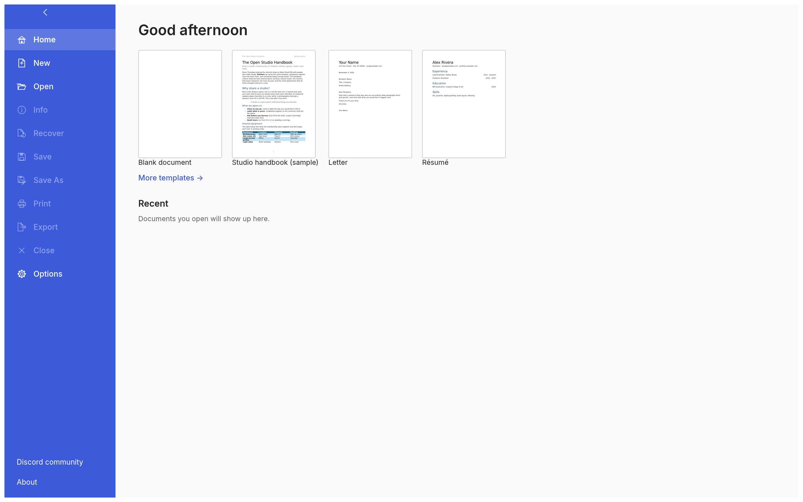
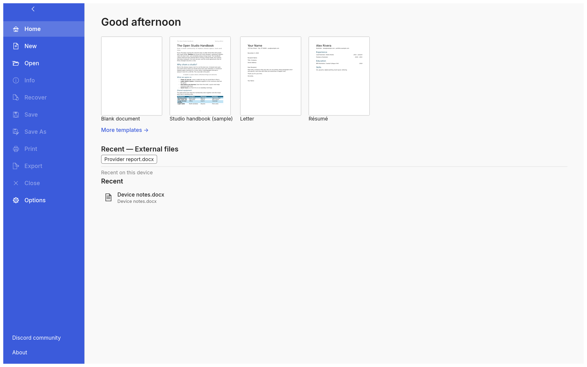

# WordCraft provider Recents — current review evidence

Editor source: `1a484ccb54b2154557e9444a4d1fbad5d5eacc26` (WordCraft0.15.0). This branch adds review images and attribution only; the application PR continues to point to the validated editor commit.

These are actual native offscreen `ui_shot` renders at1440×900 logical pixels, scale2 (2880×1800 PNG). They use synthetic resources and the same published source that passed local nine-stage `cargo xtask ci`, web all-target WASM compilation and one actual Chrome Window/native-DOCX recovery regression. The two captures did not repeat those checks. Both original PNGs were independently viewed: headings and files are readable, the complete frame is present, and local/provider lists are separate.

## Default local Home



No provider is registered. Ordinary Home and the local empty Recent list remain; no external section appears.

## Explicit provider preview



The opt-in preview seeds `Provider report.docx` under `Recent — External files` and `Device notes.docx` under the separate device history.

## Reproduction and scope

Run the existing native example with an absolute JSONL script path:

```text
cargo run --locked --offline -j1 -p wordcraft-ui-egui --example ui_shot -- /owned/run/local-start.jsonl
```

Local JSONL:

```jsonl
{"empty":true,"startScreen":true}
{"steps":4}
{"shot":"/owned/run/local-start.png"}
```

For the second capture, add `"fileProviderPreview":true` to the first request and use a different script/output path. The actual runs exited0, preserved the source/lock/fonts/catalog inputs, and produced two distinct PNGs. Native capture compilation took5m12s; the two capture commands took323.43s and0.82s.

| File | Bytes | SHA256 |
|---|---:|---|
| images/local.png | 329896 | `2a8bd1dc9bd1fe8559171bbbfe15c003241b46b3e4a594c08353142e74080417` |
| images/provider.png | 353934 | `28ddbc2640bcf127413e2323b187f2ccde2e4b62789e9be640ac5632ae444bc9` |

These images prove native Home appearance only. They do not prove browser rendering, a host chooser, authenticated storage, server durability, navigation interactions or iPad behavior. Native UI is original WordCraft code and sample content, not Microsoft Word imagery. Font files are not distributed by this evidence. Captures by @alejocapo04, under the repository’s MIT OR Apache-2.0 licence.
